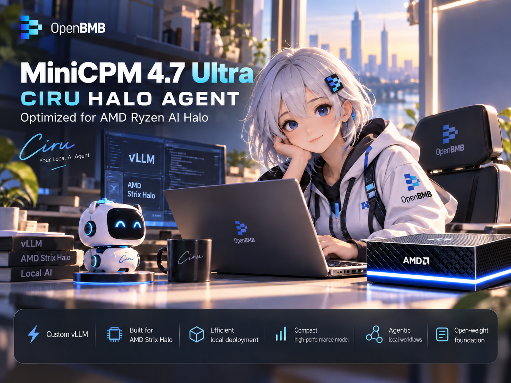

# MiniCPM 4.7 Ultra — CIRU HALO AGENT



**A local vision and coding agent built to make the most of AMD Strix Halo.**

MiniCPM 4.7 Ultra brings OpenBMB’s **35B-parameter, 3B-active MoE** vision-language model to a tuned Q8 serving stack for the Ryzen AI Max+ 395. Read screenshots and documents, write code, call tools, and run several agents together on one machine. The release combines compact expert weights, native vision, a **262,144-token context limit**, and adaptive DSpark speculative decoding.

This is a **model plus a custom Ciru vLLM runtime**. Use the included runtime: these packed Q8 weights are not GGUF and do not load through stock vLLM, llama.cpp, Ollama, or a generic Transformers pipeline.

[Download weights and runtime](https://huggingface.co/jcbtc/MiniCPM-4.7-Ultra-CIRU-HALO-AGENT/tree/main) · [GitHub](https://github.com/ciru-ai/minicpm-ciru-halo-agent) · [Installation](docs/INSTALL.md) · [Benchmark details](docs/BENCHMARKS.md)

## Why this build

- **Fast with long prompts:** about **40.5 generated tokens/s at 64K context**, with **1,969 prompt tokens/s** on the measured single-request workload.
- **Room for parallel agents:** **122.8 aggregate generated tokens/s** across eight concurrent vision/tool requests in the packaged-runtime check.
- **A completed real task:** eight agents built and repaired a 3D AMD scene in **2 minutes 22 seconds**, producing 12,992 tokens and completing all eight roles without manual design coaching.
- **One adaptive profile:** DSpark uses three draft tokens for a single active request and two for concurrent batches. No separate “fast single-user” and “fast multi-user” model copies.
- **Vision and tool use together:** image input, native tool calls, optional thinking, prefix reuse, and vision-feature caching are integrated into the same server.
- **Targeted precision:** routed expert weights use Ciru’s packed 8-bit format. The other target-model tensors, including the vision components, retain their original weights.

## Measured on one Strix Halo

AMD Ryzen AI Max+ 395 / Radeon 8060S (`gfx1151`), 128 GB unified memory, Linux. PP means prompt processing; TG means token generation. All times below start after the server is ready.

| Workload | PP, tokens/s | TG, tokens/s | Wall time |
|---|---:|---:|---:|
| **One request, 63,870-token prompt + 512 generated tokens** | **1,968.6** | **40.45** | **45.14 s** |
| Same long-context request with prefix reuse | 1,063.7¹ | 40.73 | 13.19 s |
| One vision/tool request | 2,554.8 | 40.55 | 13.98 s |
| Eight concurrent vision/tool requests | 722.7 | **122.78 aggregate**² | 63.23 s |
| Complete eight-agent 3D task | 1,015.3 | **99.80 aggregate**² | **141.81 s** |

¹ Cached PP counts only newly computed tokens: 622 in this long-context test. It does not count reused prompt tokens as newly processed work.

² Aggregate TG is output tokens divided by the union of active decode intervals across requests. It is **not single-user generation speed**. Pooled per-request TG was 21.49 for the eight-request check and 19.82 for the complete task. Across the entire 3D task, including prompt processing, tools, and orchestration, throughput was 91.61 output tokens/s.

The long-context speed test used thinking off and temperature 0.6. The vision/tool checks and 3D task used thinking on and temperature 1.0. These are different workloads, not an apples-to-apples speedup claim. Full settings, token counts, acceptance, fidelity, and limitations are in [Benchmark details](docs/BENCHMARKS.md).

## Install and run

The download includes the Q8 weights, BF16 DSpark drafter, native kernels, engine overlay, and pinned Python/ROCm foundation. **No GLM model download is required**; a historical directory name in the shared foundation is only a runtime compatibility path.

Start with a Linux Strix Halo machine with **128 GB unified memory**, working AMD GPU access, and approximately **75 GB free disk space** for the download and installed runtime. The measured configuration reserves 24 GiB for KV cache and admits up to eight requests. The 262,144-token limit is per sequence; eight simultaneous full-length contexts are not promised by that memory budget.

```bash
git clone https://github.com/ciru-ai/minicpm-ciru-halo-agent.git
cd minicpm-ciru-halo-agent
python3 -m venv .download-env
. .download-env/bin/activate
python -m pip install 'huggingface_hub>=1.0,<2'
python scripts/download.py --destination "$HOME/models/minicpm-ultra"
bash scripts/install.sh "$HOME/models/minicpm-ultra" "$HOME/.local/opt/minicpm-ultra"
bash "$HOME/.local/opt/minicpm-ultra/serve.sh" --host 127.0.0.1 --port 8095
```

Install the OS packages listed in [the installation guide](docs/INSTALL.md) first. The installer checks release checksums, installs the shared foundation only if it is absent, and refuses to overwrite an existing model-runtime directory. Foundation installation under `/opt/ciru` needs administrator access; inference runs as your normal user.

**Validation scope:** inference, vision, tools, concurrency, and numerical checks were completed on NixOS. The Ubuntu 24.04 instructions document the required userspace dependencies; see the installation guide for the exact portability checks performed. A successful CPU import is not a GPU benchmark on another distribution.

## Connect your agent

Use the OpenAI-compatible API at **`http://127.0.0.1:8095/v1`**, with model ID **`minicpm-q8`**. Your agent supplies its tools and executes the returned tool calls. The model download does not include a desktop automation application.

```bash
curl http://127.0.0.1:8095/v1/chat/completions \
  -H 'Content-Type: application/json' \
  -d '{
    "model": "minicpm-q8",
    "messages": [{"role": "user", "content": "Write a Python function that merges overlapping intervals, and explain its complexity."}],
    "temperature": 0.6,
    "top_p": 0.95,
    "top_k": 20,
    "chat_template_kwargs": {"enable_thinking": false},
    "stream": true
  }'
```

Set `enable_thinking` to `true` for reasoning. Allow sufficient remaining context for long agent work; a small client-side completion limit can cut reasoning or tool calls short. [API examples](docs/API.md) cover image inputs and tool calls.

## Precision and verification

Fresh matched-prefix comparisons against the original BF16 model measured **99.23% top-token agreement on live single-request continuations** and **99.21% on live eight-request continuations**. A separate, broader frozen-prefill panel measured **96.67%**. These panels contain different histories and positions: the figures measure numerical agreement, not task accuracy, and Q8 is not lossless. Ties are excluded consistently from those strict rates. [Counts and methodology](docs/BENCHMARKS.md#numerical-fidelity).

The installed runtime also reproduced **4,929/4,929** frozen top-token sets from the validated Q8 build, and completed ten serving checks with exact tokenizer counts and valid tool-call structure. That exact result establishes packaging parity with Q8, not BF16 equivalence.

## What is included

| Download | Purpose |
|---|---|
| `weights/` | Target model: 40 packed expert shards, three original-weight shards, tokenizer, processor, chat template, and conversion manifest |
| `runtime/minicpm-ultra-runtime.tar.zst` | Model-specific engine, plugins, native kernels, BF16 DSpark draft weights, installer, and integrity manifests |
| `runtime/ciru-rocm10-gfx1151-foundation.tar.zst` | Pinned Python 3.14 / PyTorch / ROCm / Triton / AITER foundation |
| `release.json` | Download sizes, SHA-256 identities, and component provenance |
| GitHub `source/` | Model adapters, kernel sources, engine Python sources, and license notices |

## Credits and license

Built on [OpenBMB MiniCPM-V-4.7-35B-A3B](https://huggingface.co/openbmb/MiniCPM-V-4.7-35B-A3B) and its [DSpark drafter](https://huggingface.co/openbmb/MiniCPM-V-4.7-35B-A3B-DSpark). Runtime work builds on [vLLM](https://github.com/vllm-project/vllm), [AMD ROCm](https://github.com/ROCm), [AITER](https://github.com/ROCm/aiter), and [Triton](https://github.com/triton-lang/triton). The BF16 prefill work also credits **asf0** and [halo-box/strix-llama.cpp PR #172](https://github.com/halo-box/strix-llama.cpp/pull/172), with upstream attribution preserved in the source.

The model and Ciru-authored release code are Apache-2.0. Bundled third-party components retain their own licenses; see [NOTICE](NOTICE) and the included license files. This is an independent Ciru optimization release, not an official AMD or OpenBMB product.
